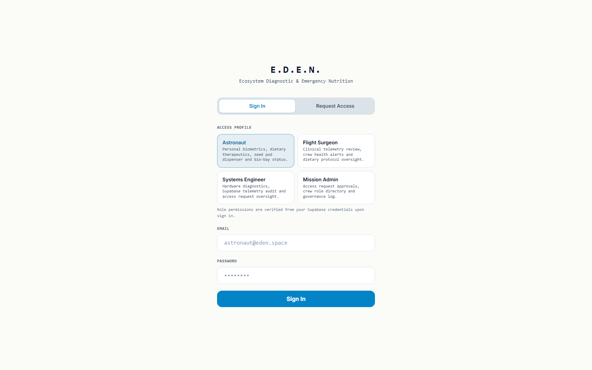
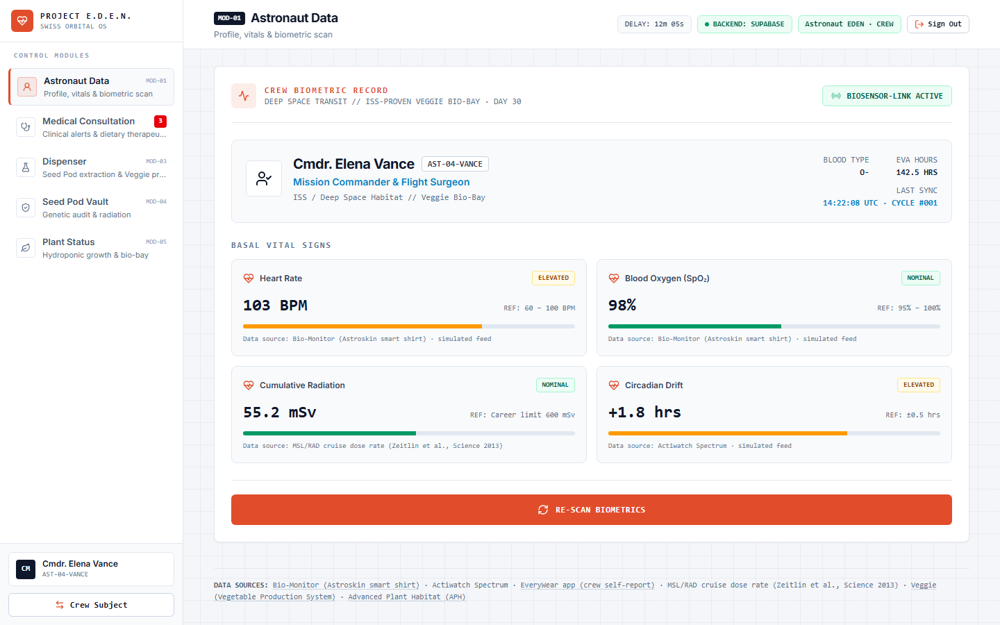
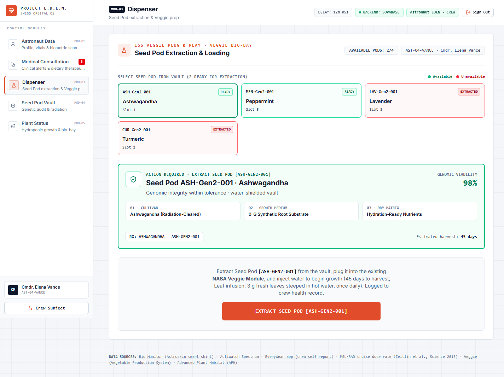

# Project E.D.E.N. — Team Dyeus

**NASA Space Apps Challenge 2026 · Astronaut health monitoring**

In deep space, a message to Earth can take up to ~22 minutes each way, so astronauts cannot wait for a doctor on the ground. Project E.D.E.N. is an autonomous dashboard that connects two systems NASA already has but that do not talk to each other: **crew health monitoring** and **space agriculture**.

When the astronaut's health log shows a problem, E.D.E.N. prescribes a plant to grow on board, audits the seed vault so it only uses seeds whose DNA was not damaged by radiation, and tells the crew which **Seed Pod** to plug into NASA's Veggie greenhouse. We don't synthesize pills; we automate targeted agriculture.

**Live demo:** https://nasa-space-challenge-team-dyeus.vercel.app

> **Sign-in required.** Crew health data is private, so the dashboard opens on a sign-in screen. A demo account for judges is provided in the **submission notes** (credentials are never stored in this public repository).



## How it works

1. **Health alert.** The astronaut's latest record in `astronaut_log` (stress, inflammation, cognitive, cardiovascular, nutrition and bone levels, heart rate, sleep, symptoms) is read every 15 seconds. Any level above `LOW` becomes an alert. Each value shows the ISS research hardware that would produce it on orbit (CSA's Bio-Monitor, Actiwatch Spectrum, CNES's EveryWear app), marked **simulated feed** in this prototype.
2. **Dietary prescription.** Each alert is matched with a plant in the `plants` table. Crops NASA has already grown in space (Veggie / Advanced Plant Habitat) are preferred; Earth-only candidates are labeled **NOT FLIGHT-VALIDATED**.
3. **Seed vault audit.** The cumulative radiation dose of each seed cartridge is estimated from the cruise dose rate measured by MSL/RAD (1.84 mSv/day). Cartridges past the damage threshold are rejected and the rest are authorized. In this prototype, seed viability is a **modeled** value, not a lab measurement (see [Feasibility](#feasibility)).
4. **Extract the Seed Pod.** The crew extracts the authorized pod (e.g. `ASH-Gen2-001`) from the vault: the pod is marked `growing` and the action is written to `dispense_log`. The pod plugs into NASA's existing Veggie greenhouse and is watered by hand.
5. **Consumption.** No chemical processing: crops are eaten fresh or as a hot-water infusion, using hardware already on the ISS. Dried powder is shown as a next step.

The mission scene is a **deep-space transit that uses ISS-proven Veggie hardware**: the Earth delay and radiation dose are computed for that distance, not for low Earth orbit.

## Screens

| View | What it shows |
| --- | --- |
| Astronaut Data | Crew profile, vital signs, cumulative radiation vs. the 600 mSv career limit |
| Medical Consultation | Active clinical alerts and the therapeutic nutrition recommendation |
| Dispenser | Seed Pod selection, extraction and Veggie plug-in instructions |
| Seed Pod Vault | Genetic audit of the vault (approved / rejected cartridges) |
| Plant Status | Pods in cultivation and the botanical registry |
| Access Control | Access requests and crew directory (doctor, engineer and admin roles) |


| Astronaut Data | Dispenser |
| --- | --- |
|  |  |

| Seed Pod Vault | Plant Status |
| --- | --- |
|  |  |

| Pod extracted | Mobile |
| --- | --- |
|  |  |

## Security model

Crew health data is private, so the whole dashboard requires sign-in (Supabase Auth). Access is enforced **in the database** with Row Level Security on every table, not only in the interface: a modified browser or a direct API call gets the same answer.

| What | No session (public key) | Astronaut (`paciente`) | Systems engineer (`programador`) | Flight surgeon (`doctor`) | `admin` |
| --- | --- | --- | --- | --- | --- |
| Plant catalog | read | read | read | read | read |
| Health records (`astronaut_log`) | insert readings **without an owner** (sensor bridge) | own records only | read all | read all | read all |
| Crew profiles | — | own | own | all | all |
| Seed vault / extract a `ready` pod | — | yes | yes | yes | yes |
| Add or reset pods | — | — | yes | yes | yes |
| Dispense history | — | read, add | read, add | read, add | read, add |
| Access requests | submit (`pending` only) | submit | submit | submit | review and approve |
| Create accounts with a role | — | — | — | — | yes (server-side) |
| Who viewed my record (`profile_views`) | — | yes | yes | yes | yes |

- **Nobody can change their own role.** `user_profiles` has no update policy. Self sign-up (*New User*) always creates an astronaut account, and a database trigger ignores any role sent by the client.
- **Admin account creation** runs in a Supabase Edge Function (`provision-user`). It checks that the caller is an admin, and the service key lives only on the server.
- **An account without a role sees nothing.** Reading the vault, the dispense history and extracting pods all require a role.
- **Defense in depth.** The public key has no table write privileges except the two it needs. No role can `TRUNCATE`. The site sends a strict Content-Security-Policy (scripts only from its own origin, network only to Supabase), plus `X-Frame-Options: DENY`, `nosniff`, `Referrer-Policy` and `Permissions-Policy` (see [`vercel.json`](vercel.json)).
- **Audit trail.** Opening a crew member's record from the doctor view is logged in `profile_views`, and the patient can see it.
- **Secrets.** Only the public anon key is in the frontend. No service keys or passwords are stored in this repository.
- **Verified by tests.** [`tests/rls.mjs`](tests/rls.mjs) attacks the live database (extract pods without a session, inject health readings for an astronaut, grant yourself admin, approve your own request…) and checks that each attempt is rejected by RLS.

### New users

There are three ways to get an account:

1. ***New User*** on the sign-in screen. You get an astronaut account right away.
2. ***Request Access*** for another role. An admin approves the request in Access Control.
3. **An admin creates the account** with any role from Access Control (*Add New Crew User*).

## Feasibility

E.D.E.N. adds **software, not flight hardware**. Everything it asks the crew to do uses equipment that has already flown:

- **Growing.** NASA's Veggie has been on the ISS since 2014. It is crew-tended and watered by hand, and astronauts first ate Veggie-grown lettuce in 2015. The automated Advanced Plant Habitat grew chile peppers that the crew ate in 2021 (Plant Habitat-04). E.D.E.N. prefers crops already grown in these systems and labels the rest **NOT FLIGHT-VALIDATED**.
- **Eating.** Leaves are eaten fresh or steeped in hot water from the station's galley. No extraction, no pills, no new processing equipment. Drying into powder is shown only as a future step.
- **Why it matters.** NASA's Human Research Program lists *inadequate food and nutrition* as a risk for long missions: stored food loses nutrients over time and fresh produce helps. Light-time delay is why the dashboard decides on board instead of waiting for Earth.

**What is real and what is modeled in this prototype**

| Item | Status |
| --- | --- |
| Cruise radiation dose rate (1.84 mSv/day) and the 600 mSv career limit | Real published values (MSL/RAD; NASA standard) |
| Cumulative dose per astronaut / per seed cartridge | Modeled: days in space × dose rate |
| Seed viability % and the "damaged / authorized" verdict | Modeled demo values |
| Health readings (heart rate, levels, sleep) | Simulated feed (seed data or the Arduino mock wearable in [`hardware/`](hardware/)) |
| Greenhouse sensors (pH, temperature, light) | Simulated |
| Plant–condition matches | From the plant catalog, with the evidence level shown for each plant |

**Limits.**

- This is dietary support, not a medical device. The flight surgeon stays in the loop: the doctor view shows every crew member's alerts.
- Crops take weeks to grow, so they suit chronic and preventive needs (stress, inflammation, bone and nutrition), not emergencies.
- Next steps would be connecting a real wearable feed and calibrating seed viability with radiation datasets from NASA's Open Science Data Repository (GeneLab).

## Tech stack

- **Frontend:** React 19, Vite 6, Tailwind CSS 4, lucide-react
- **Backend:** Supabase (PostgreSQL + REST API + Auth), accessed with plain `fetch` (no SDK)
- **Hosting:** Vercel (deploys automatically from `main`)
- **Hardware (optional):** Arduino sketch that simulates a wearable biosensor and feeds `astronaut_log` — see [`hardware/`](hardware/)

## Data model (Supabase)

| Table | Purpose |
| --- | --- |
| `astronaut_log` | Astronaut health records (levels, vitals, symptoms, days in space, owner `user_id`) |
| `plants` | Plant catalog: condition, plant, active compound, serving, grow time, NASA-grown flag, evidence |
| `seed_cartridges` | Seed Pod inventory (`pod_id`, slot, status, prescribed patient) |
| `dispense_log` | Every extracted pod: plant, serving, notes, linked health record |
| `user_profiles` | Role and name of each Supabase Auth user |
| `access_requests` | Access requests from the sign-in screen (`pending` / `approved` / `rejected`) |
| `profile_views` | Audit log of who viewed which crew profile |

The data layer lives in [`src/data/api.js`](src/data/api.js). If Supabase is unreachable, the app falls back to demo data so it never breaks.

Database setup lives in [`supabase/`](supabase/), applied in this order:

1. `auth_roles_setup.sql`: roles and policies (idempotent).
2. `close_public_reads.sql`: private data requires a session.
3. `security_hardening.sql`: closes public writes and requires a role.
4. `signup_trigger.sql`: every new account gets a profile with the astronaut role.

The other files:

- `functions/provision-user/`: Edge Function for admin account creation.
- `plantas_iss.sql`: NASA-grown crops.
- `reset_demo_pods.sql`: resets the demo Seed Pods after a rehearsal.

## Backups

[`supabase/backup.mjs`](supabase/backup.mjs) exports every table, the RLS policies, the triggers and the functions to `backups/<date>/` as JSON. That folder is git-ignored because it contains health data, so keep the copy somewhere private.

`--restore-sql` turns a backup into a `restore.sql` that re-inserts missing rows without overwriting existing ones. Review it and run it in the Supabase SQL Editor.

```bash
SUPABASE_ACCESS_TOKEN=<personal token> node supabase/backup.mjs
node supabase/backup.mjs --restore-sql backups/<date>
```

## Run locally

```bash
npm install
cp .env.example .env    # fill VITE_SUPABASE_URL and VITE_SUPABASE_ANON_KEY
npm run dev
```

Build for production with `npm run build`.

## Tests

[`tests/e2e.mjs`](tests/e2e.mjs) is a dependency-free end-to-end test (Node 22+ and Edge/Chrome). It signs in, walks the five mission views on desktop (1440×900) and mobile (390×844), extracts a Seed Pod, and reports console errors, HTTP errors and layout overflow. Database writes are intercepted, so it never changes real data.

```bash
node tests/e2e.mjs https://nasa-space-challenge-team-dyeus.vercel.app out/e2e
```

[`tests/rls.mjs`](tests/rls.mjs) checks the database security rules against the live project (20 checks; rejected writes leave no data):

```bash
node tests/rls.mjs
```

Both tests read the demo account from a local `CUENTAS_DEMO.local.txt` (or the path in `CREDENTIALS_FILE`), which is ignored by git.

## Space agency data and references

- NASA Human Research Program — Risks of Human Spaceflight: https://www.nasa.gov/hrp/risks/
- NASA — Risk of Inadequate Food and Nutrition: https://www.nasa.gov/reference/risk-of-inadequate-food-and-nutrition/
- NASA Veggie (Vegetable Production System): https://www.nasa.gov/missions/station/so-you-want-to-be-a-space-farmer/
- NASA Advanced Plant Habitat (Plant Habitat-04, chile peppers, 2021): https://science.nasa.gov/mission/advanced-plant-habitat/
- NASA Open Science Data Repository (OSDR) & GeneLab: https://science.nasa.gov/biological-physical/data/osdr/
- Bio-Monitor and EveryWear (ISS research): https://www.nasa.gov/mission_pages/station/research/experiments/explorer/
- Cruise radiation dose rate (~1.84 mSv/day): Zeitlin et al., *Science* 340 (2013), MSL/RAD measurements during the Earth–Mars cruise.

## Use of AI

AI tools were used as thought partners and coding assistants during the 48-hour hackathon; the team made the final decisions.

- **Gemini (Google):** brainstorming the Living Pharmacy concept, structuring documents, refining the pitch, and building the multi-window interface and sign-in screen (via an AI coding agent).
- **Claude / Claude Code (Anthropic):** the Supabase data layer and authentication (`src/data/api.js`), database security policies, the account-creation Edge Function, the Arduino bridge, backups, security and end-to-end tests, and code review.

## Team

Team Dyeus — NASA Space Apps Challenge 2026.

## License

[MIT](LICENSE)
