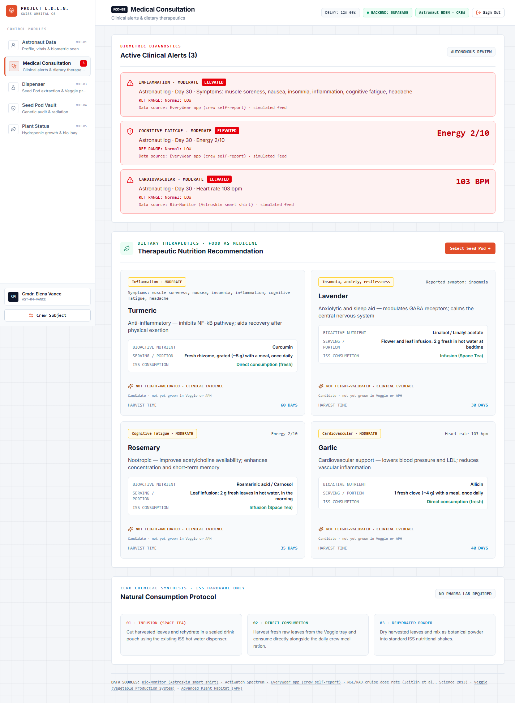
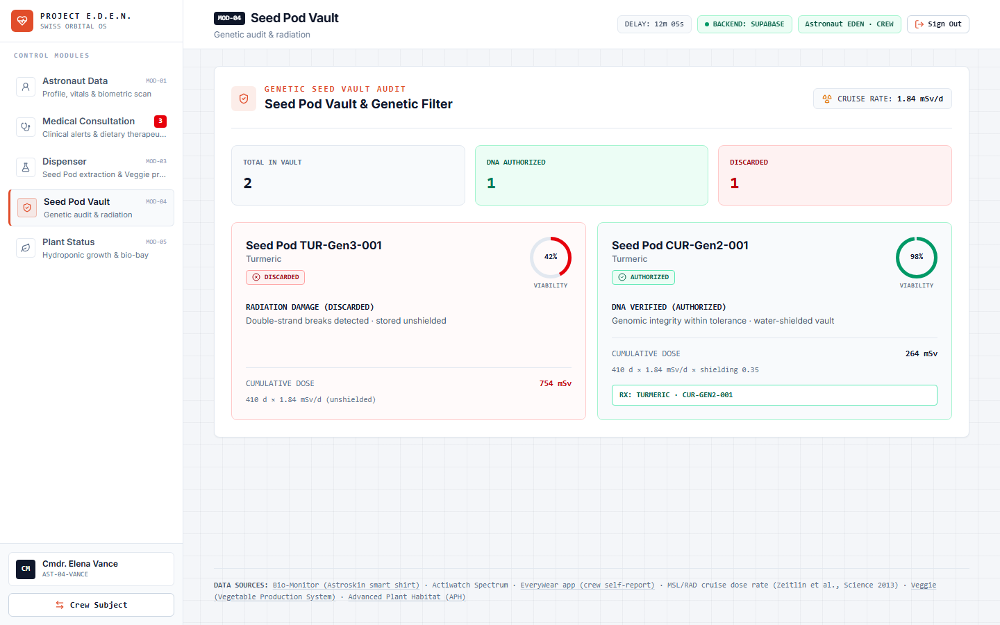
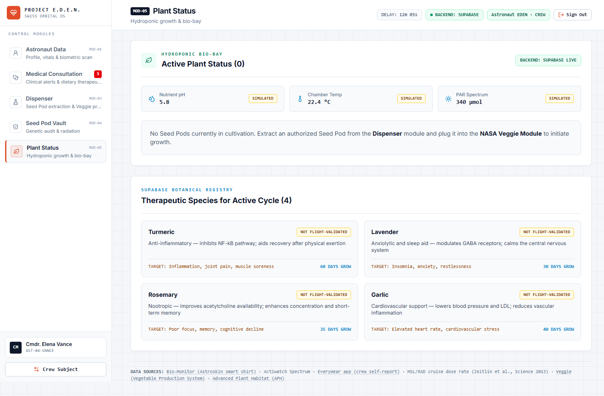
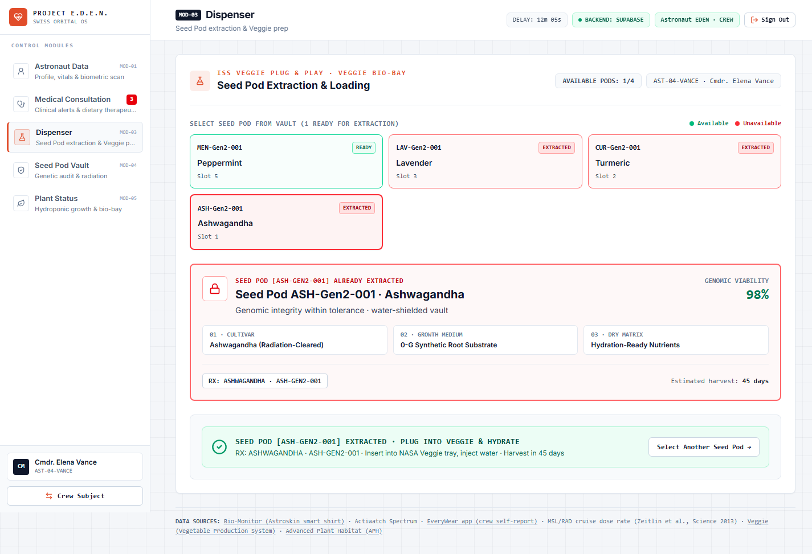
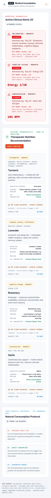

# Project E.D.E.N. — Team Dyeus

**NASA Space Apps Challenge 2026 · Astronaut health monitoring**

In deep space, a message to Earth can take up to ~22 minutes each way, so astronauts cannot wait for a doctor on the ground. Project E.D.E.N. is an autonomous dashboard that connects two systems NASA already has but that do not talk to each other: **crew health monitoring** and **space agriculture**.

When the astronaut's health log shows a problem, E.D.E.N. prescribes a plant to grow on board, audits the seed vault so it only uses seeds whose DNA was not damaged by radiation, and tells the crew which **Seed Pod** to plug into NASA's Veggie greenhouse. We don't synthesize pills; we automate targeted agriculture.

**Live demo:** https://nasa-space-challenge-team-dyeus.vercel.app

> **Sign-in required.** Crew health data is private, so the dashboard opens on a sign-in screen. A demo account for judges is provided in the **submission notes** (credentials are never stored in this public repository).


## How it works

1. **Health alert.** The astronaut's latest record in `astronaut_log` (stress, inflammation, cognitive, cardiovascular, nutrition and bone levels, heart rate, sleep, symptoms) is read every 15 seconds. Any level above `LOW` becomes an alert. Each value shows the NASA device that would produce it on orbit (Bio-Monitor, Actiwatch Spectrum, EveryWear), marked **simulated feed** in this prototype.
2. **Dietary prescription.** Each alert is matched with a plant in the `plants` table. Crops NASA has already grown in space (Veggie / Advanced Plant Habitat) are preferred; Earth-only candidates are labeled **NOT FLIGHT-VALIDATED**.
3. **Seed vault audit.** The cumulative radiation dose of each seed cartridge is computed from the cruise dose rate measured by MSL/RAD (1.84 mSv/day). Damaged cartridges are rejected; DNA-verified ones are authorized.
4. **Extract the Seed Pod.** The crew extracts the authorized pod (e.g. `ASH-Gen2-001`) from the vault: the pod is marked `growing` and the action is written to `dispense_log`. The pod plugs into NASA's existing Veggie greenhouse and is watered by hand.
5. **Consumption.** No chemical processing: crops are eaten fresh or as a hot-water infusion, using hardware already on the ISS. Dried powder is shown as a next step.

The mission scene is a **deep-space transit that uses ISS-proven Veggie hardware**: the Earth delay and radiation dose are computed for that distance, not for low Earth orbit.

## Screens

| View | What it shows |
| --- | --- |
| Astronaut Data | Crew profile, vital signs, cumulative radiation vs. the 600 mSv career limit |
| Medical Consultation | Active clinical alerts and the therapeutic nutrition recommendation |
| Dispenser | Seed Pod selection, extraction and Veggie plug-in instructions |
| Seed Pod Vault | Genetic audit of the vault (approved / rejected cartridges) |
| Plant Status | Pods in cultivation and the botanical registry |
| Access Control | Access requests and crew directory (doctor, engineer and admin roles) |



| Astronaut Data | Dispenser |
| --- | --- |
|  |  |

| Seed Pod Vault | Plant Status |
| --- | --- |
|  |  |

| Pod extracted | Mobile |
| --- | --- |
|  |  |

## Access and security

- **Sign-in with Supabase Auth.** Four roles: `paciente` (astronaut), `doctor` (flight surgeon), `programador` (systems engineer) and `admin`.
- **Row Level Security on every table.** Without a session, the public key can only read the plant catalog, submit an access request and insert health readings (the wearable/Arduino feed). Health records, dispense history and the seed vault require a session.
- **By role:** astronauts see only their own records and profile; doctors and admins see every crew profile; only admins approve or reject access requests. Nobody can change their own role.
- **New users** ask for access from the sign-in screen (*Request Access*); requests always enter as `pending`.
- Only the public anon key is used in the frontend. No service keys or passwords are stored in this repository.

## Tech stack

- **Frontend:** React 19, Vite 6, Tailwind CSS 4, lucide-react
- **Backend:** Supabase (PostgreSQL + REST API + Auth), accessed with plain `fetch` (no SDK)
- **Hosting:** Vercel (deploys automatically from `main`)
- **Hardware (optional):** Arduino sketch that simulates a wearable biosensor and feeds `astronaut_log` — see [`hardware/`](hardware/)

## Data model (Supabase)

| Table | Purpose |
| --- | --- |
| `astronaut_log` | Astronaut health records (levels, vitals, symptoms, days in space, owner `user_id`) |
| `plants` | Plant catalog: condition, plant, active compound, serving, grow time, NASA-grown flag, evidence |
| `seed_cartridges` | Seed Pod inventory (`pod_id`, slot, status, prescribed patient) |
| `dispense_log` | Every extracted pod: plant, serving, notes, linked health record |
| `user_profiles` | Role and name of each Supabase Auth user |
| `access_requests` | Access requests from the sign-in screen (`pending` / `approved` / `rejected`) |
| `profile_views` | Audit log of who viewed which crew profile |

The data layer lives in [`src/data/api.js`](src/data/api.js). If Supabase is unreachable, the app falls back to demo data so it never breaks.

Database setup lives in [`supabase/`](supabase/): `auth_roles_setup.sql` (roles and policies, idempotent), `close_public_reads.sql` (private data requires a session), `plantas_iss.sql` (NASA-grown crops) and `reset_demo_pods.sql` (resets the demo Seed Pods after a rehearsal).

## Run locally

```bash
npm install
cp .env.example .env    # fill VITE_SUPABASE_URL and VITE_SUPABASE_ANON_KEY
npm run dev
```

Build for production with `npm run build`.

## Tests

[`tests/e2e.mjs`](tests/e2e.mjs) is a dependency-free end-to-end test (Node 22+ and Edge/Chrome). It signs in, walks the five mission views on desktop (1440×900) and mobile (390×844), extracts a Seed Pod, and reports console errors, HTTP errors and layout overflow. Database writes are intercepted, so it never changes real data.

```bash
node tests/e2e.mjs https://nasa-space-challenge-team-dyeus.vercel.app out/e2e
```

The test reads the demo account from a local `CUENTAS_DEMO.local.txt` (or the path in `CREDENTIALS_FILE`), which is ignored by git.

## Space agency data and references

- NASA Human Research Program — Risks of Human Spaceflight: https://www.nasa.gov/hrp/risks/
- NASA — Risk of Inadequate Food and Nutrition: https://www.nasa.gov/reference/risk-of-inadequate-food-and-nutrition/
- NASA Veggie (Vegetable Production System): https://www.nasa.gov/missions/station/so-you-want-to-be-a-space-farmer/
- NASA Advanced Plant Habitat (Plant Habitat-04, chile peppers, 2021): https://science.nasa.gov/mission/advanced-plant-habitat/
- NASA Open Science Data Repository (OSDR) & GeneLab: https://science.nasa.gov/biological-physical/data/osdr/
- Bio-Monitor and EveryWear (ISS research): https://www.nasa.gov/mission_pages/station/research/experiments/explorer/
- Cruise radiation dose rate (~1.84 mSv/day): Zeitlin et al., *Science* 340 (2013), MSL/RAD measurements during the Earth–Mars cruise.

## Use of AI

AI tools were used as thought partners and coding assistants during the 48-hour hackathon; the team made the final decisions.

- **Gemini (Google):** brainstorming the Living Pharmacy concept, structuring documents, refining the pitch, and building the multi-window interface and sign-in screen (via an AI coding agent).
- **Claude / Claude Code (Anthropic):** the Supabase data layer and authentication (`src/data/api.js`), database security policies, the Arduino bridge, end-to-end tests and code review.

## Team

Team Dyeus — NASA Space Apps Challenge 2026.

## License

[MIT](LICENSE)
